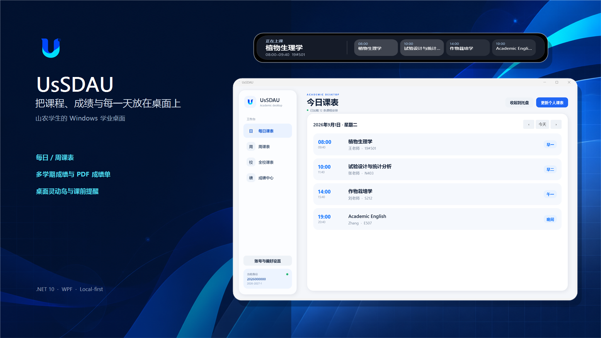
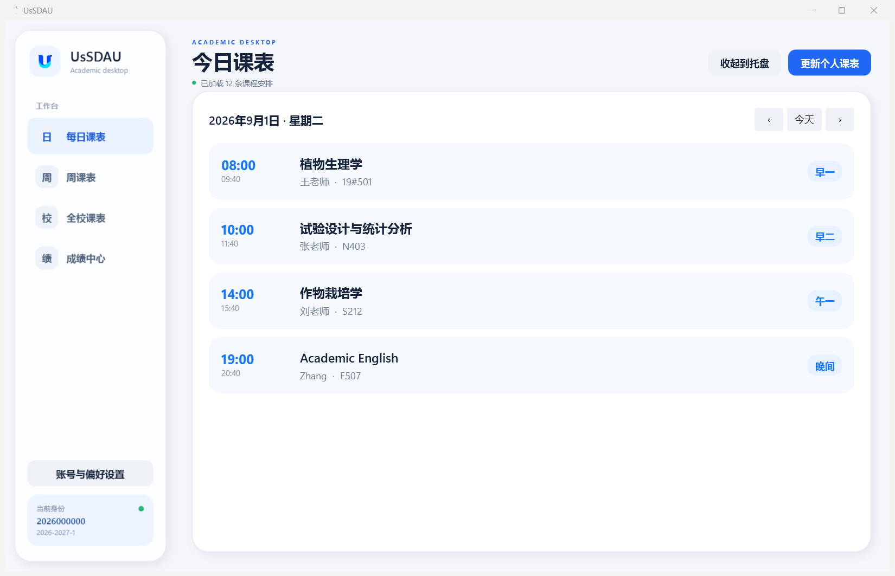
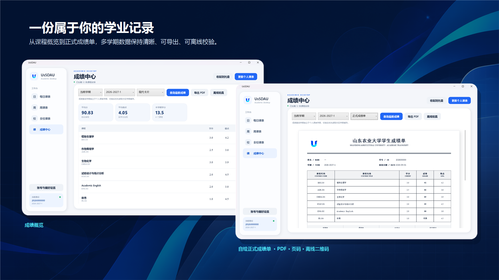
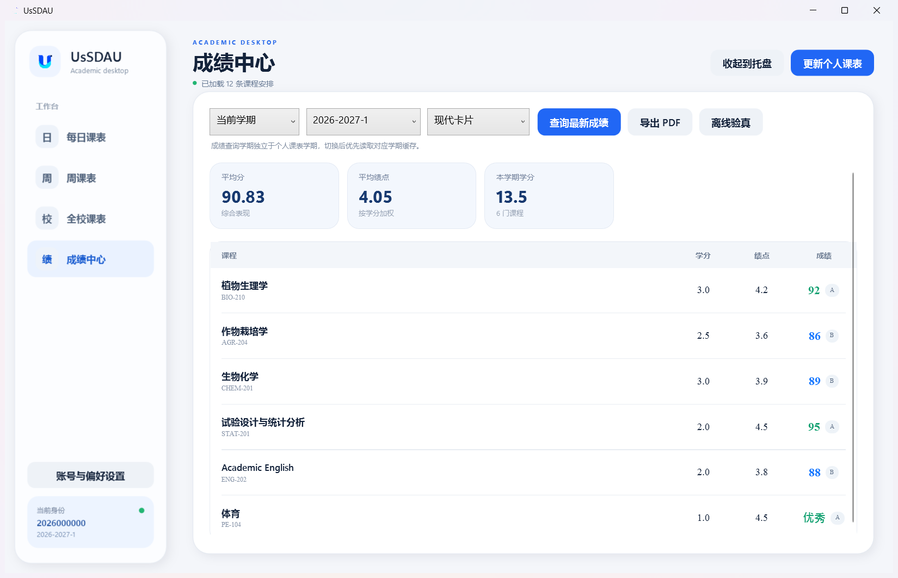
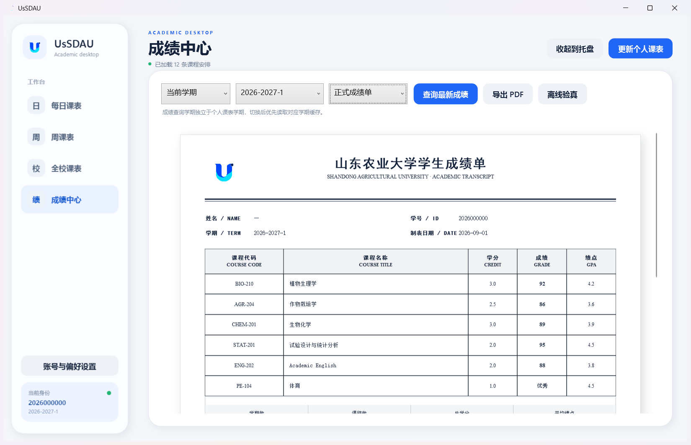
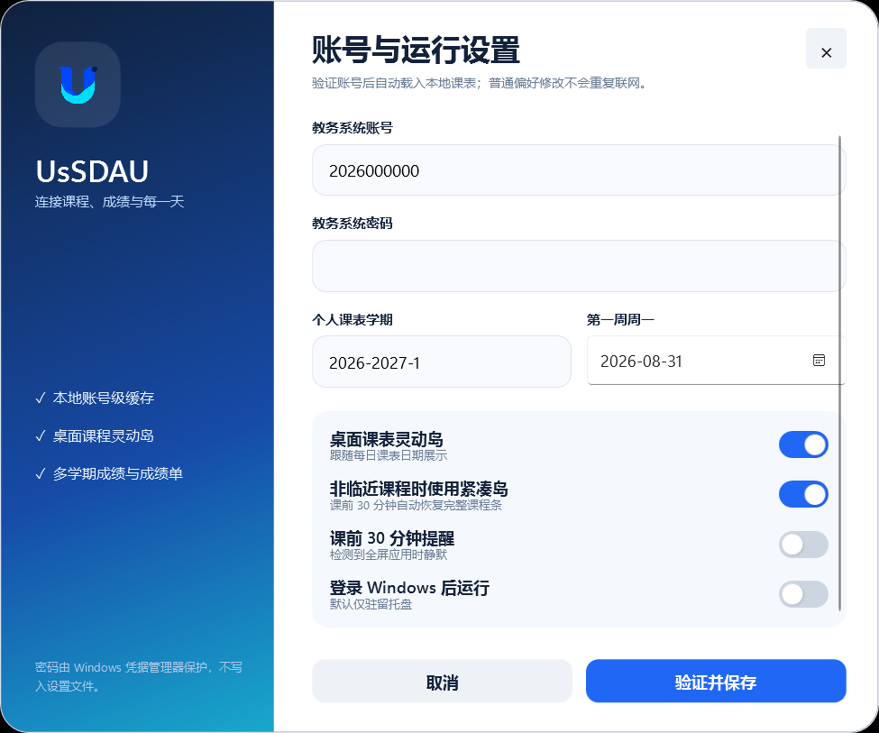

<div align="center">
  
  <h1>UsSDAU</h1>
  <p><strong>把课程、成绩与每一天放在桌面上。</strong></p>
  <p>面向山东农业大学学生的 Windows 学业桌面，基于 WPF 与 .NET 10。</p>

  <p>
    
    
    
    
  </p>
</div>



UsSDAU 将个人课表、全校课表、成绩查询和桌面提醒集中到一个常驻托盘的 Windows 应用中。教务密码保存在 Windows 凭据管理器，课程和成绩按账号、学期缓存在本机；应用启动后不重复联网，只有首次验证或用户明确执行查询/更新时才访问教务系统。

> [!IMPORTANT]
> UsSDAU 是学生辅助工具，不是山东农业大学官方应用。课程、成绩与教室信息以学校教务系统为准。

## 核心体验

<table>
  <tr>
    <td width="33%" valign="top"><strong>桌面课表</strong><br/>每日与周课表使用真实教学周过滤课程，自动切换冬夏作息，并支持浏览任意日期。</td>
    <td width="33%" valign="top"><strong>顶部灵动岛</strong><br/>展示当前/下一节课程和当天安排；空闲后自动收起到屏幕上缘，悬停、日期变化或提醒时滑下展开。</td>
    <td width="33%" valign="top"><strong>全校课表</strong><br/>按学院、年级、专业和班级四级筛选，查看当前教学周的班级课程。</td>
  </tr>
  <tr>
    <td valign="top"><strong>独立成绩学期</strong><br/>成绩学期与个人课表学期完全解耦，可自由切换并读取对应缓存。</td>
    <td valign="top"><strong>三种成绩视图</strong><br/>现代概览、正式成绩单和红笔批注使用不同的信息结构，但共享同一成绩详情入口。</td>
    <td valign="top"><strong>总成绩单与 PDF</strong><br/>遍历全部学期，按学期分组并计算总学分、平均分和累计绩点；导出带页码、水印与离线校验码的 A4 PDF。</td>
  </tr>
</table>

## 软件截图

### 每日课表与灵动岛



<p align="center">
  
</p>

灵动岛默认位于屏幕工作区顶端。状态保持不变一段时间后，窗口向上收起，只在顶部留下可悬停的底边；鼠标移入、课程状态变化、切换每日课表日期或触发课前提醒时自动展开。

### 成绩、成绩单与离线校验



<table>
  <tr>
    <td width="50%"></td>
    <td width="50%"></td>
  </tr>
  <tr>
    <td align="center"><strong>现代成绩概览</strong></td>
    <td align="center"><strong>自绘正式成绩单</strong></td>
  </tr>
</table>

正式成绩单不使用原生 `DataGrid`：中文正文采用宋体，表头采用黑体，英文与数字采用 Times New Roman。PDF 第 1 页是“山东农业大学学生成绩册”封面，包含身份、学业范围、累计汇总、签名指纹和离线二维码；正文每个新学期从新页开始，单页最多排 17 门课程并在学期末紧跟小计。

### 账号与运行设置

<p align="center">
  
</p>

密码不会写入 `settings.json`，而是保存到当前 Windows 用户的凭据管理器。普通外观与运行偏好修改不会重新请求课表。

## 功能清单

### 课表

- [x] 个人课程表账号级、学期级缓存
- [x] 按天与按周展示
- [x] 浏览日期时同步顶部灵动岛
- [x] 两小节合并为一个大节
- [x] 5 月 1 日至 8 月 1 日使用夏季作息，其余日期使用冬季作息
- [x] 学周范围过滤
- [x] 全校课表镜像下载与四级筛选
- [x] 托盘手动更新，避免后台自动请求教务系统

### 成绩

- [x] 成绩查询学期独立于课表学期
- [x] 现代列表、正式成绩单、红笔批注三种界面
- [x] 点击成绩查看平时/期末构成
- [x] 遍历并汇总全部可用成绩学期
- [x] 学期小计、总学分、平均分与累计绩点
- [x] A4 成绩册封面、按学期分页、正文页码与自有品牌水印
- [x] 本机 ECDSA 签名与离线二维码完整性校验

### 桌面与提醒

- [x] 系统托盘常驻与单实例运行
- [x] 专用 16–32px 托盘图标
- [x] 可选 Windows 登录后启动
- [x] 课前 30 分钟蓝色强调
- [x] 前台全屏应用检测与提醒静默
- [x] 灵动岛课程卡按当天课程数量自动分配宽度
- [x] 空闲自动收起，悬停/提醒自动展开

## 作息时间

课程以两小节为一个大节。实验课等跨四小节安排会保留更长的结束时间。

| 大节 | 冬季作息 | 夏季作息（5.1–8.1，含） |
|---|---|---|
| 早一 | 08:00–08:45，08:55–09:40 | 08:00–08:45，08:55–09:40 |
| 早二 | 10:00–10:45，10:55–11:40 | 10:00–10:45，10:55–11:40 |
| 午一 | 14:00–14:45，14:55–15:40 | 14:30–15:15，15:25–16:10 |
| 午二 | 16:00–16:45，16:55–17:40 | 16:30–17:15，17:25–18:10 |
| 晚间 | 19:00–19:45，19:55–20:40 | 19:30–20:15，20:25–21:10 |

## 离线完整性校验

PDF 最后一页的二维码使用以下流程生成：

1. 对成绩单身份、学期、课程行与累计汇总建立确定性 CBOR 摘要。
2. 使用 ES256（ECDSA P-256 + SHA-256）生成 COSE_Sign1 签名。
3. 使用 Brotli 压缩并通过 Base45 编码为 `USSD1:` 载荷。
4. 私钥优先保存于 TPM 的 Microsoft Platform Crypto Provider；无 TPM 时回退到不可导出的 Windows Software KSP。
5. 扫描二维码后，将文本粘贴到“离线验真”窗口即可在无服务器环境验证签名和载荷完整性。

这是一种本机自签的防篡改机制：它可以证明二维码中的数据自导出后没有被修改，但不能替代学校签章或建立山东农业大学官方身份。应用不会把教务密码用于派生签名密钥。

## 系统要求

- Windows 10 或 Windows 11（x64）
- [.NET 10 Desktop Runtime](https://dotnet.microsoft.com/download/dotnet/10.0)
- 可访问山东农业大学教务系统

## 快速开始

### 使用发布版本

发布目录位于：

```text
artifacts/win-x64/
```

请保留目录中的全部文件，然后运行 `UsSDAU.exe`。首次启动会提示配置学号、教务密码、个人课表学期和第一周周一日期。

### 从源代码运行

```powershell
git clone <your-repository-url>
cd UsSDAU

dotnet restore .\UsSDAU.slnx
dotnet run --project .\UsSDAU.csproj
```

### 构建与发布

```powershell
dotnet build .\UsSDAU.slnx -c Release

dotnet publish .\UsSDAU.csproj `
  -c Release `
  -r win-x64 `
  --self-contained false `
  -p:PublishSingleFile=true `
  -o .\artifacts\win-x64
```

## 配置与本地数据

| 内容 | 位置 |
|---|---|
| 普通设置 | `%LOCALAPPDATA%\UsSDAU\settings.json` |
| 课表/成绩缓存 | `%LOCALAPPDATA%\UsSDAU\cache\` |
| 教务密码 | Windows 凭据管理器：`UsSDAU:Academic:<学号>` |
| 成绩单签名私钥 | Windows CNG KSP：`UsSDAU.Transcript.Signing.v1` |

开发、测试或截图时可设置 `USSDAU_DATA_DIR`，让设置和缓存写入隔离目录：

```powershell
$env:USSDAU_DATA_DIR = "$PWD\.local-demo"
dotnet run --project .\UsSDAU.csproj -- --open
```

## 项目结构

```text
UsSDAU/
├─ Assets/                         品牌 Logo、应用图标与托盘图标
├─ docs/images/                    README 宣传图和隔离演示截图
├─ Models/AcademicModels.cs        课程、成绩、学期与作息策略
├─ Services/
│  ├─ AppController.cs             应用状态与账号级数据协调
│  ├─ SdauAcademicService.cs       教务登录、课表、成绩与全校课表协议
│  ├─ CacheService.cs              账号/学期级 JSON 缓存
│  ├─ SettingsService.cs           设置、Windows 凭据与开机启动
│  ├─ TranscriptPdfService.cs      A4 成绩单分页与 PDF 导出
│  └─ TranscriptVerificationService.cs  COSE/ES256 离线签名与二维码
├─ Windows/                        设置、灵动岛、提醒、成绩详情与验真窗口
├─ tools/Generate-Promo.ps1        可复现 README 宣传图生成脚本
├─ MainWindow.xaml(.cs)            主桌面体验
└─ UsSDAU.slnx
```

## 技术与依赖

- WPF / .NET 10
- WPF Fluent Theme
- [PDFsharp](https://github.com/empira/PDFsharp) — PDF 生成
- [QRCoder](https://github.com/Shane32/QRCoder) — QR 码生成
- `System.Formats.Cbor` — 确定性 CBOR 与 COSE 载荷
- Windows Credential Manager / CNG / TPM

界面采用 Fluent 2 启发的字阶、间距、层级与语义色，并加载 .NET WPF 内置 Fluent Theme。宣传图背景由 OpenAI ImageGen 生成，软件窗口均来自 `USSDAU_DATA_DIR` 隔离演示环境的真实截图。

## 当前状态

UsSDAU 目前是 Windows 桌面原型。教务系统页面或接口调整后，解析规则可能需要同步更新；请不要把本工具生成的成绩单当作学校正式材料提交。

## 致谢

感谢 [ClassIsland](https://github.com/ClassIsland/ClassIsland) 项目提供的灵动岛思路，这一设计方案极大的改善了课表的用户体验。

感谢 [WeSDAU](https://github.com/Sleexycg/WeSDAU) 项目提供的教务系统解析思路，直接抄代码很爽。
